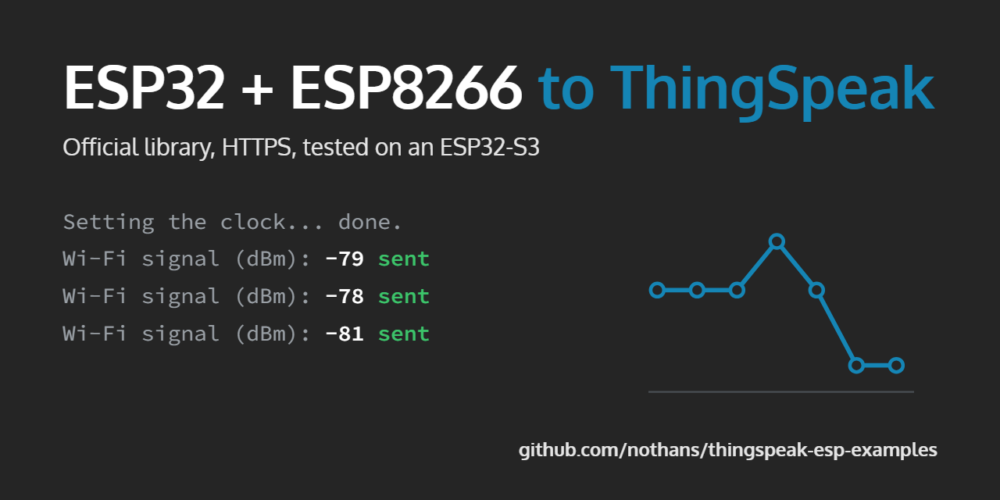

# ThingSpeak ESP examples

Arduino sketches that send data from an ESP32 or ESP8266 to a [ThingSpeak](https://thingspeak.mathworks.com/) channel over HTTPS, using the official [ThingSpeak library](https://github.com/mathworks/thingspeak-arduino) by MathWorks.



Each sketch connects to Wi-Fi, sets the board's clock, checks ThingSpeak's certificate, and writes one value to Field 1 every 20 seconds.
The Wi-Fi signal sketches need no wiring, so they confirm that a board, a network, and a channel all work.

## Quick start

1. In the Arduino IDE 2, install the board package: **esp32 by Espressif Systems** or **esp8266 by ESP8266 Community** (Boards Manager URL `https://arduino.esp8266.com/stable/package_esp8266com_index.json`).
2. Install **ThingSpeak by MathWorks** from the Library Manager.
3. Create a channel at [thingspeak.mathworks.com](https://thingspeak.mathworks.com/) with Field 1 turned on.
4. Open `examples/ESP32/RSSI_to_ThingSpeak` (or the `ESP8266` one), and fill in `secrets.h` with the Wi-Fi name and password, the channel number, and the Write API Key.
5. Upload, then open the Serial Monitor at 115200 baud.

## Example

`RSSI_to_ThingSpeak` on an ESP32-S3 (esp32 core 4.0.0, ThingSpeak library 2.1.1), run on 2026-11-24:

```
Connecting to MyNetwork..... connected.
Setting the clock... done.
Wi-Fi signal (dBm): -79 sent to ThingSpeak.
Wi-Fi signal (dBm): -79 sent to ThingSpeak.
Wi-Fi signal (dBm): -79 sent to ThingSpeak.
Wi-Fi signal (dBm): -78 sent to ThingSpeak.
```

## Sketches

| Sketch | Board | Sends |
|---|---|---|
| [`ESP32/RSSI_to_ThingSpeak`](examples/ESP32/RSSI_to_ThingSpeak) | ESP32, ESP32-S3, ESP32-C3 | Wi-Fi signal strength in dBm |
| [`ESP32/Analog_to_ThingSpeak`](examples/ESP32/Analog_to_ThingSpeak) | ESP32, ESP32-S3, ESP32-C3 | `analogRead(A0)` |
| [`ESP8266/RSSI_to_ThingSpeak`](examples/ESP8266/RSSI_to_ThingSpeak) | NodeMCU, WeMos D1 mini | Wi-Fi signal strength in dBm |
| [`ESP8266/Analog_to_ThingSpeak`](examples/ESP8266/Analog_to_ThingSpeak) | NodeMCU, WeMos D1 mini | `analogRead(A0)` |

- Sends over HTTPS and trusts only DigiCert Global Root G2, the root that `api.thingspeak.com` chains to, valid until 2038
- Sets the clock from NTP before connecting, because certificate checks need the date
- Reconnects to Wi-Fi when the connection drops
- Prints the library's status code when a write fails

## Tested

- Compiled on 2026-11-24 for ESP32, ESP32-S3, and ESP32-C3 on esp32 core 4.0.0, for ESP32-S3 on core 3.3.3, and for NodeMCU and WeMos D1 mini (esp8266 core 3.1.2), with ThingSpeak library 2.1.1; no warnings.
- Both ESP32 sketches ran on an ESP32-S3 and wrote to a ThingSpeak channel.
  A build with the wrong root certificate failed with code -301, as expected.
- The ESP8266 sketches were compiled, not run on hardware.

## Limits

- If ThingSpeak moves to a certificate authority other than DigiCert, writes fail with code -301 until `thingspeak_root_ca.h` is updated.
  The file's header shows how to check the current chain.
- On ESP32 cores 3.x and 4.x, ThingSpeak library 2.1.1 does not detect the secure client and falls back to port 80.
  The ESP32 sketches define `WiFiClientSecure_h` before including `ThingSpeak.h` to work around it.
- The free ThingSpeak plan accepts one update every 15 seconds per channel.

## Documentation

- [Building the Internet of Things with the ESP8266, ESP32, and ThingSpeak](https://nothans.com/thingspeak-tutorials/esp8266/building-the-internet-of-things-with-the-esp8266-wi-fi-module-and-thingspeak): the step-by-step tutorial for these sketches
- [ThingSpeak library for Arduino](https://github.com/mathworks/thingspeak-arduino): the library's API and more examples
- [ThingSpeak Write Data API](https://www.mathworks.com/help/thingspeak/writedata.html)

## License

[MIT](LICENSE)
